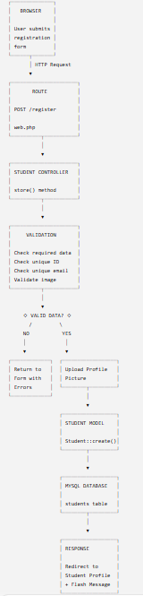
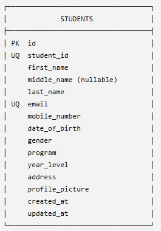
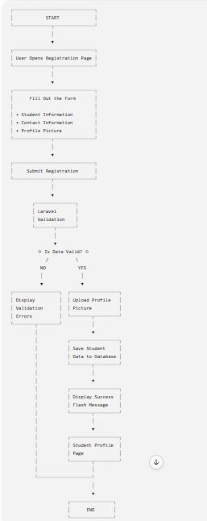

# Student Registration System

A Laravel-based student registration web application developed for the Week 4 Student Registration System activity. It collects student information, validates submitted data, stores accepted records in a database, uploads a profile picture, and displays a student profile.

## Table of Contents
- [Introduction](#introduction)
- [Objectives](#objectives)
- [Technology Stack](#technology-stack)
- [Setup and Run](#setup-and-run)
- [Laravel Request Lifecycle](#laravel-request-lifecycle)
- [Validation Rules](#validation-rules)
- [Database Design](#database-design)
- [Registration Flowchart](#registration-flowchart)
- [Screenshots](#screenshots)
- [Problems Encountered](#problems-encountered)
- [Solutions](#solutions)
- [Reflection](#reflection)
- [References](#references)

## Introduction

A Student Registration System is a web application that gathers, validates, stores, and presents student information in a consistent format. This project provides a registration form for details such as student ID, name, email, mobile number, date of birth, gender, academic program, year level, address, and profile picture. After successful submission, the system saves the record and opens a profile page.

Data validation is important because users may leave required fields empty, submit incorrectly formatted values, or reuse identifiers that must be unique. Validation helps protect data quality before information reaches persistent storage. It also gives users clear feedback so they can correct mistakes.

Registration systems are common parts of enterprise applications, including school information systems, employee onboarding platforms, customer relationship management systems, and membership portals. They provide a structured way to capture records that other workflows can use.

## Objectives

The activity aims to:
- Build a registration form using Laravel Blade.
- Define routes that display the form, process submissions, and show a student profile.
- Use a controller to handle incoming requests.
- Apply server-side validation to submitted form data.
- Enforce unique student IDs and email addresses.
- Upload an image using Laravel's file storage system.
- Store validated student data with an Eloquent model.
- Design a database table with a primary key, unique constraints, and timestamps.
- Display validation errors and a success flash message.
- Practice organizing a Laravel project and documenting its workflow.

## Technology Stack

- **Backend:** PHP and Laravel
- **Views:** Blade templates
- **Database:** The configured Laravel database connection (SQLite or MySQL, depending on `.env`)
- **ORM:** Laravel Eloquent
- **Frontend assets:** Vite and Tailwind CSS
- **File storage:** Laravel `public` disk

## Setup and Run

Prerequisites: PHP compatible with the Laravel version in `composer.json`, Composer, Node.js/npm, and a configured database.

1. Open the project folder in VS Code.
2. Install PHP dependencies:
   ```bash
   composer install
   ```
3. Create your local environment file if it does not exist:
   ```bash
   copy .env.example .env
   ```
   On macOS/Linux, use `cp .env.example .env`.
4. Generate an application key:
   ```bash
   php artisan key:generate
   ```
5. Configure the database settings in `.env`. Ensure the selected database exists if using MySQL.
6. Run migrations:
   ```bash
   php artisan migrate
   ```
7. Install and build frontend assets:
   ```bash
   npm install
   npm run build
   ```
8. Create the public storage link so uploaded profile pictures can be served:
   ```bash
   php artisan storage:link
   ```
9. Start the development server:
   ```bash
   php artisan serve
   ```
10. Visit `http://127.0.0.1:8000/register`.

Do not commit `.env` or real student data to GitHub. Keep credentials private.

## Laravel Request Lifecycle

The diagram below summarizes how a submitted registration travels through the application.



1. **Browser:** The user completes the form and submits an HTTP `POST` request to `/register`. The form includes a CSRF token and `multipart/form-data` encoding for the image.
2. **Route:** `routes/web.php` matches `POST /register` to `StudentController@store`.
3. **Controller:** The controller receives the Laravel `Request`.
4. **Validation:** `$request->validate()` checks the submitted fields. If validation fails, Laravel redirects back with errors and old input; the database insert does not proceed.
5. **Model:** If valid, the controller stores the uploaded picture and calls `Student::create($validated)`. The model's `$fillable` list permits the intended attributes for mass assignment.
6. **Database:** Eloquent inserts the student record into the `students` table.
7. **Response:** Laravel redirects to `/students/{student}`. The profile view displays the saved details and a session flash success message.

## Validation Rules

The current rules are defined in `app/Http/Controllers/StudentController.php`.

| Field / rule | Current implementation | Why it matters |
|---|---|---|
| Student ID | `required\|unique:students,student_id` | Requires an identifier and prevents duplicate student IDs. |
| First name | `required\|string\|max:100` | Ensures the field is present, textual, and within a reasonable length. |
| Middle name | `nullable\|string\|max:100` | Allows students without a middle name while validating a supplied value. |
| Last name | `required\|string\|max:100` | Ensures a core identity field is provided. |
| Email | `required\|email\|unique:students,email` | Checks email format and prevents duplicate email addresses. |
| Mobile number | `required\|numeric` | Requires a value that PHP/Laravel can interpret as numeric. For real phone numbers, a string plus a phone-format rule is often better because phone numbers may start with zero or include `+`. |
| Date of birth | `required\|date` | Rejects missing or unparseable dates. |
| Gender, program, year level, address | `required` | Requires these registration details, though stricter `in:`/`string`/length rules would improve robustness. |
| Profile picture | `required\|image\|mimes:jpg,jpeg,png\|max:2048` | Requires an image, limits accepted extensions/types, and caps file size at 2,048 KB (2 MB). |

**Required fields** prevent incomplete records. **Unique constraints** avoid duplicate identifiers and emails; the database also has unique indexes, providing protection if concurrent requests attempt the same value. **Email validation** checks that the submitted value resembles an email address but does not prove that the mailbox exists. **Numeric validation** is useful for numeric data, but a phone number is usually better stored as text to preserve leading zeros and symbols. **Image validation** reduces the risk of accepting arbitrary files in an image field. **File-size restrictions** limit storage consumption and reduce oversized uploads.

Validation is currently server-side. Browser-side checks can improve convenience but should not replace server-side validation, because clients can bypass browser controls.

## Database Design

### Entity Relationship Diagram (ERD)



The current application uses one main application table, `students`. Each successful registration creates one row. The Laravel framework may also use separate infrastructure tables for sessions, cache, jobs, or users depending on the selected configuration; these are not part of the student registration relationship shown in the ERD.

### `students` table structure

The schema is defined in `database/migrations/2026_08_29_112940_create_students_table.php`.

| Column | Laravel schema / typical SQL type | Constraints / purpose |
|---|---|---|
| `id` | `$table->id()` / unsigned big integer | Primary key, auto-incrementing |
| `student_id` | `string` / `VARCHAR(255)` by default | Required; unique |
| `first_name` | `string` / `VARCHAR(255)` | Required by application validation |
| `middle_name` | `string` / `VARCHAR(255)` | Nullable |
| `last_name` | `string` / `VARCHAR(255)` | Required by application validation |
| `email` | `string` / `VARCHAR(255)` | Unique |
| `mobile_number` | `string` / `VARCHAR(255)` | Stored as text |
| `date_of_birth` | `date` / `DATE` | Date value |
| `gender` | `string` / `VARCHAR(255)` | Registration selection |
| `program` | `string` / `VARCHAR(255)` | Academic program |
| `year_level` | `string` / `VARCHAR(255)` | Year-level selection |
| `address` | `text` / `TEXT` | Address may be longer than a short string |
| `profile_picture` | `string` / `VARCHAR(255)` | Stores the relative storage path, not the image binary |
| `created_at` | timestamp / `TIMESTAMP` | Set by Eloquent |
| `updated_at` | timestamp / `TIMESTAMP` | Updated by Eloquent |

**Primary key:** `id` uniquely identifies each database row.  
**Unique constraints:** `student_id` and `email` must not be duplicated.  
**Nullable constraint:** `middle_name` may be `NULL`.  
**Application-level constraints:** the controller validates required fields, accepted image formats, and maximum image size before inserting a record.

The uploaded image is stored on Laravel's `public` storage disk in `profile-pictures/`; the database stores the relative file path. A public storage symlink is needed for the profile page's `asset('storage/...')` URL to resolve.

## Registration Flowchart



The flow starts when a user opens the registration form, enters information, and submits it. Laravel validates the request. Invalid data returns the user to the form with errors; valid data is used to store the image and create a student record. The application then redirects to the student profile and displays a success flash message.

## Screenshots

Place your own screenshots in `screenshots/` and use the suggested filenames below. The archive provided for documentation did not include the required evidence screenshots, so these items are intentionally listed as a checklist rather than represented by fabricated images.

- [ ] `screenshots/registration-form.png` — Registration Form
- [ ] `screenshots/validation-errors.png` — Validation Errors (try submitting missing or duplicate data)
- [ ] `screenshots/successful-registration.png` — Successful Registration
- [ ] `screenshots/flash-message.png` — Success Flash Message
- [ ] `screenshots/uploaded-profile-picture.png` — Uploaded Profile Picture on profile page
- [ ] `screenshots/database-table.png` — `students` table with a sample record
- [ ] `screenshots/student-profile.png` — Student Profile Page
- [ ] `screenshots/vscode-project-structure.png` — Project open in VS Code
- [ ] `screenshots/github-repository.png` — GitHub repository page

Use sample or fictional student information in screenshots. Avoid exposing real personal information, credentials, or `.env` values.

## Problems Encountered

The following are common issues relevant to this implementation. Keep only the entries that accurately describe what you personally experienced, and add any other problems you encountered.

1. **Validation errors not appearing beside every field.** Some inputs have explicit `@error` blocks while the form also has a general error list. If a field lacks its own `@error` block, its message may only appear in the general list.
2. **Profile picture not displaying.** Laravel can save an image under `storage/app/public/profile-pictures`, but the browser cannot serve it through `/storage/...` until the public storage symlink exists.
3. **Database migration or connection failure.** A missing database, incorrect `.env` credentials, or a migration that has not run can prevent registration from being saved.
4. **Duplicate student ID or email.** Reusing a previously registered unique value fails validation, which is expected behavior rather than a database defect.

## Solutions

1. **Show validation feedback:** Use Laravel's `$request->validate()` and display `$errors` in the Blade view. Add `@error('field_name')` near each input when field-specific feedback is needed.
2. **Fix image access:** Run `php artisan storage:link`, verify the public disk configuration, and confirm the profile picture path is stored correctly.
3. **Fix database problems:** Check `.env`, confirm the database exists, then run `php artisan migrate`. Review the terminal error before retrying; avoid destructive commands such as `migrate:fresh` if existing data must be preserved.
4. **Handle duplicates:** Keep unique validation rules and database unique indexes. Test with a new student ID and email for a successful registration.

## Reflection

Building the Student Registration System helped me understand that collecting information through a form is only one part of creating a reliable web application. A system must also check the information, handle files carefully, store records consistently, and give the user a clear response. Laravel helped organize these responsibilities through routes, controllers, validation, models, migrations, and Blade views.

One important lesson was the value of validation. Users may accidentally omit a field, enter an incorrectly formatted email address, or submit a student ID that already exists. If the application accepted every value without checking it, the database could contain incomplete or conflicting records. Rules such as `required`, `email`, and `unique` help maintain data quality. Validation also improves usability because the application can explain what needs to be corrected instead of failing unexpectedly. Database constraints are important too: they provide another layer of protection when more than one request attempts to create the same unique value.

I also learned that server-side validation is necessary even when client-side validation is available. HTML input types and JavaScript can help users catch mistakes quickly, but they run in the browser and can be bypassed. A user can disable scripts or send a request through a different tool. Laravel checks the request on the server before the application creates the database record. Client-side checks are useful for convenience, while server-side rules are the trusted enforcement point.

Handling a profile picture introduced another responsibility: file security. An uploaded file should not be trusted simply because the user selected it. The application should validate that it is an allowed image type and keep its size within a reasonable limit. Storing the file through Laravel's storage system and saving its relative path in the database separates the file from the student record. The public storage link must also be configured so that the intended image can be displayed. In a larger application, developers should consider additional controls such as randomized filenames, image processing, upload quotas, and private storage for sensitive documents.

The activity also demonstrated how the Laravel request lifecycle connects different parts of a system. A route directs the request to a controller, validation checks the input, the model creates the record, and the database persists it. The response then redirects to the profile page and presents a success message. Breaking the process into these responsibilities makes the code easier to understand and maintain.

In real enterprise software, registration workflows are used for students, employees, customers, patients, and members. Accurate records support later activities such as enrollment, communication, reporting, billing, and access management. A small registration project therefore teaches principles that apply to much larger systems: validate input, enforce data integrity, protect uploaded files, provide useful feedback, and document the design. Overall, this activity strengthened my understanding of how Laravel features work together to turn a form into a complete data-entry workflow.

## References

Laravel. (n.d.). *Laravel documentation*. Retrieved October 17, 2026, from https://laravel.com/docs

MDN Web Docs. (n.d.). *HTML forms*. Retrieved October 17, 2026, from https://developer.mozilla.org/en-US/docs/Learn_web_development/Extensions/Forms

MySQL. (n.d.). *MySQL 8.4 reference manual*. Retrieved October 17, 2026, from https://dev.mysql.com/doc/

PHP Documentation Group. (n.d.). *PHP manual*. Retrieved October 17, 2026, from https://www.php.net/manual/en/

Tailwind Labs. (n.d.). *Tailwind CSS documentation*. Retrieved October 17, 2026, from https://tailwindcss.com/docs
